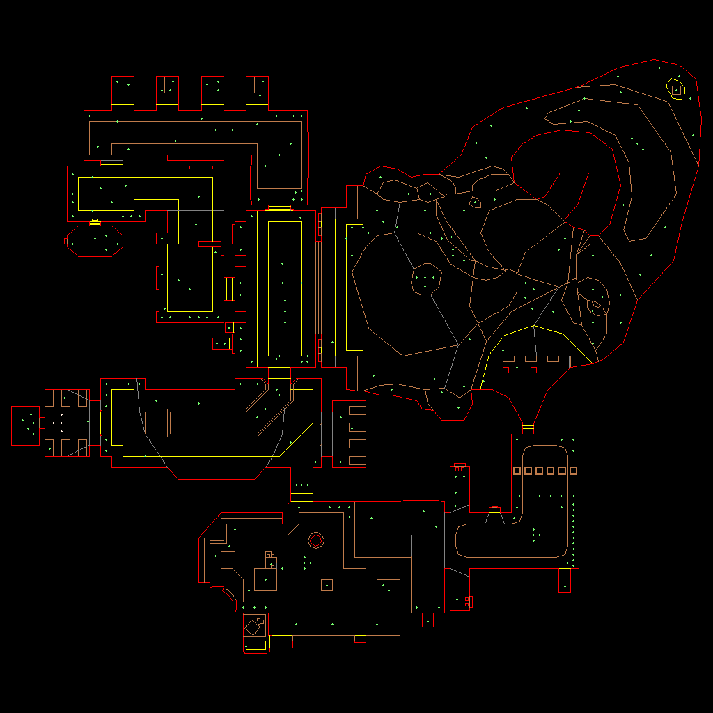

# bendoom

The whole of Doom, rewritten in [Bend 2](https://github.com/bendlang/bend): every episode of Doom and Doom II, every monster and weapon, menus, saves, the automap and the original demos playing in sync. It is built in stages.

## Stages

| | Stage | State |
|---|---|---|
| 1 | WAD and maps: any IWAD's directory, every map lump, the palette, the automap as an image | done |
| 2 | Walls: BSP traversal, composite textures, light and colormaps, a window | |
| 3 | Floors, ceilings, sky, sprites and masked textures | |
| 4 | Player and world: movement, collision, doors, lifts, line and sector specials | |
| 5 | Every monster, with the original states and AI | |
| 6 | Weapons, items, ammo, HUD and status bar | |
| 7 | Menus, in-game automap, skills, intermission, finales, every episode and Doom II | |
| 8 | Sound, music, saves and `.lmp` demos, played back in sync | |

## Use

    bend automap.bend -o automap
    ./automap doom.wad E1M1 e1m1.bmp

    bend wadinfo.bend -o wadinfo
    ./wadinfo doom2.wad

`automap` draws a map the way Doom's automap does with every line revealed: one-sided walls red, floor steps brown, ceiling steps yellow, the rest grey, things as green crosses and player starts white, in the WAD's own palette. `wadinfo` prints every map with the count and a hash of each of its lumps.

Any Doom-format IWAD works: Doom, Doom II, Final Doom, or [Freedoom](https://freedoom.github.io), which is free and what the tests use.

## Tests

`./test.sh` downloads Freedoom 0.13.0 (checked by SHA-256), reads all 68 maps of `freedoom1.wad` and `freedoom2.wad` and compares every field of every lump with `tests/wadinfo.py`, an independent reader in Python, then checks three automaps against their known images. `BEND=path/to/bend ./test.sh` picks the compiler.

## Layout

| File | What |
|---|---|
| `src/wad.bend` | the WAD header and directory, lumps read on demand at their offset |
| `src/level.bend` | a map's lumps as typed records |
| `src/tab.bend` | `Vec`, a shared, indexable table for data read once and looked up often |
| `src/bytes.bend`, `src/i32.bend` | little-endian words, lump names, signed 32-bit arithmetic on `U32` |
| `src/automap.bend`, `src/bmp.bend` | the automap drawn into an array, written as a BMP |

## Limits

- **Bend 2.0.36**, native build (`-o`). The programs run under `bend file.bend` too, but a whole WAD overflows the JS lane's stack.
- Map nodes must be in Doom's original format; ZDoom's extended nodes come later, with PWAD support.

The code is GPL-2.0, the license of Doom's source. The WADs are not included.
