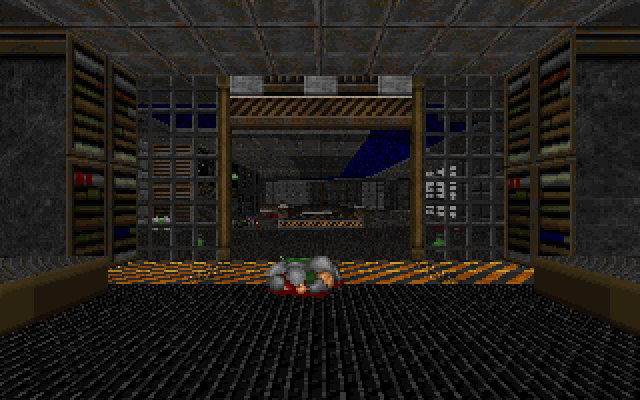

# bendoom

The whole of Doom, rewritten in [Bend 2](https://github.com/bendlang/bend): every episode of Doom and Doom II, every monster and weapon, menus, saves, the automap and the original demos playing in sync. It is built in stages.

## Stages

| | Stage | State |
|---|---|---|
| 1 | WAD and maps: any IWAD's directory, every map lump, the palette, the automap as an image | done |
| 2 | Walls: BSP traversal, composite textures, light and colormaps, a window | done |
| 3 | Floors, ceilings, sky, sprites and masked textures | done |
| 4 | Player and world: movement, collision, doors, lifts, line and sector specials | done |
| 5 | Every monster, with the original states and AI | done |
| 6 | Weapons, items, ammo, HUD and status bar | done |
| 7 | Menus, in-game automap, skills, intermission, finales, every episode and Doom II | done |
| 8 | Sound, music, saves and `.lmp` demos, played back in sync | done |

## Use

    bend doom.bend -o doom
    ./doom doom.wad
    ./doom doom.wad E1M1
    ./doom doom2.wad -file mymaps.wad MAP01
    ./doom doom.wad -soundfont gm.sf2
    DMXOPTION=-opl3 ./doom doom.wad

`doom` opens a 640x400 window and runs the game at Doom's 35 tics a second. With only a WAD it starts at the title screen, which cycles through the title, credits and help pages until a key opens the main menu; with a map it starts on that map at the medium skill. The arrow keys or W and S walk and turn, A and D or comma and period strafe, Shift runs, Ctrl or F fires, Space or E uses and 1 to 7 pick a weapon. Escape opens the menu: new game with its episode and skill screens, options with messages, detail, screen size, mouse sensitivity and volumes, the read-this pages, end game and quit, with the arrow keys, Enter and Backspace, and Y or N for the questions; F1 to F10 are the help, save, load, sound, quick save, end game, messages, quick load and quit keys of the original. Minus and equals shrink and grow the view, as the screen size slider does, and F5 toggles low detail. Tab opens the automap, where the arrows pan, minus and equals zoom, 0 shows the whole map, F follows the player, G draws the grid, M marks a spot and C clears the marks. The cheats are id's: iddqd, idkfa, idfa, idclip or idspispopd, idbehold with v, s, i, r, a or l for each power-up, and iddt in the automap.

The simulation is a port of id's: movement with momentum, friction, view bob and step-ups; collision against walls, things and the blockmap; doors, locked doors, lifts, floors, ceilings, crushers, stairs, donuts and light effects; walk, use and shoot line specials, switches and their timed return, teleports, animated flats and textures, scrolling walls, damaging and secret sectors; item pickups; and the exit, which loads the next map, or a death, which restarts the current one. Monsters see, hear, chase and attack as id's do: sight through the REJECT table and the BSP, sound flooding through sectors, melee, hitscan and missile attacks, homing revenant rockets, the arch-vile's resurrections and flame, pain elementals and lost souls, the boss deaths that open E1M8 and MAP07, and the Icon of Sin's cube spawner. Every weapon fires as id's do, from the fist and chainsaw to the BFG, with its raise, lower, refire and flash states, autoaim, ammo use and the switch when it runs out. The status bar shows ammo, health, armor, arms, keys and the face, which looks around, grins, winces and turns toward the damage with the same random numbers as the original; pickup and locked-door messages show at the top, and damage, bonus and radiation suits tint the palette. The view takes vanilla's eleven sizes, the smaller ones framed by the border flat and bevel and the largest dropping the status bar, and low detail renders at half width with doubled pixels; the border, the messages and the status bar redraw on the same frames as the original's. Invulnerability inverts the whole view, light amplification lights it, and partial invisibility draws the player's weapon with the fuzz effect of spectres, whose position carries from frame to frame and level to level as the original's does. Finishing a map shows the intermission, with kills, items, secrets and times counted up and the next map's place on the episode map; the end of an episode, Doom II's text screens between its chapters and the end of the game play the finales, from the bunny scroller to the cast call.

Sound effects are mixed in 8 channels at 22050 Hz with vanilla's channel stealing, distance attenuation and stereo separation, started wherever the original starts them: doors, lifts, switches, pickups, weapons, monsters, menus, the intermission and the finales. Music plays the WAD's MUS and MIDI lumps through a port of Chocolate Doom's OPL driver, the `GENMIDI` instruments on 9 voices, into an FM synthesizer modelled on Nuked OPL3 at 11025 Hz, sample for sample what that driver and chip produce. With `-opl3` in the `DMXOPTION` environment variable, as in Chocolate Doom, the driver runs in OPL3 mode: 18 voices, the four waveforms only the OPL3 has, and stereo, with the pan controller sending each channel left, right or to both sides, on DMX's reversed sides. With `-soundfont FILE.sf2` the same songs play as General MIDI through that SoundFont instead, on a 32-voice wavetable synthesizer at 22050 Hz in stereo, a port of TinySoundFont: its SoundFont reader, region and generator rules, envelopes, LFOs, low-pass filter, pitch bend, sustain, exclusive classes and channel controllers, with the MUS controllers mapped as Chocolate Doom's `mus2mid.c` maps them. Each level, the intermission, the finales and the title pick their song, and the options menu sets both volumes. The six save slots write `doomsav0.dsg` to `doomsav5.dsg` in vanilla's layout, byte for byte what Chocolate Doom writes apart from the memory pointers vanilla dumps along with the structures, so saves move between this port and Chocolate Doom both ways; as in vanilla, a lift waiting in stasis and flickering lights are not saved, and sector heights keep only their whole units. The title loop plays the WAD's demos between its pages.

    bend shot.bend -o shot
    ./shot doom.wad E1M1 e1m1.bmp

`shot` renders the same view from the player start, with the status bar and weapon, into a 320x200 BMP.

    bend walk.bend -o walk
    ./walk doom.wad E1M1 out.bmp 200 1 at 600 712 180 2 128

`walk` plays a script without a window and saves the last frame. Each pair is a number of tics and the keys held through them as a bit mask: 1 forward, 2 back, 4 and 8 turn left and right, 16 and 32 strafe left and right, 64 run, 128 use, 65536 fire, and 512, 1024 and so on up to 32768 pick weapons 1 to 7. `at X Y ANGLE` places the player. It prints the player's position, floor height, whether the level was exited, and the player's health.

    bend demo.bend -o demo
    ./demo doom.wad E1M1 run.lmp
    ./demo doom.wad E1M1 run.lmp 200 frame.bmp

`demo` plays a vanilla `.lmp` demo's tic commands without a window and prints one line per tic: the level time, the random index, the player's position, angle and health, the number of mobjs and a hash of every mobj's position, angle, state, tics, health and flags, and a hash of the player's weapon, ammo and weapon sprites. A tic and a file name save that tic's frame as a BMP, and `give` before them starts the player with every weapon and full ammo. `keys TIC CODE DOWN ... end` presses and releases keys at given tics, with the window's key codes, so the menus and the automap can be driven from a demo, and `every N PREFIX` saves every Nth frame as `PREFIX_TIC.bmp`. The same line printed by a reference engine shows where the two part. `sound` prints the sound starts instead: the tic, the sound and the kind of thing that made it. `savegame TIC` saves the game to `doomsav0.dsg` in the current directory when the level time reaches that tic, and with `title` in place of the demo, `loadgame` loads that file before the first tic.

    bend listen.bend -o listen
    ./listen doom.wad E1M1 run.lmp run.wav

    bend song.bend -o song
    ./song doom.wad D_E1M1 60 e1m1.wav

`listen` plays a demo without a window and writes its sound effects and music to a 22050 Hz stereo WAV. `song` renders a music lump for the given number of seconds, looping, to a 11025 Hz mono WAV, stereo in OPL3 mode, or with `-soundfont FILE.sf2` to a 22050 Hz stereo WAV in General MIDI. Both take `-file` and `-soundfont` as `doom` does.

    bend automap.bend -o automap
    ./automap doom.wad E1M1 e1m1.bmp

    bend wadinfo.bend -o wadinfo
    ./wadinfo doom2.wad

`automap` draws a map the way Doom's automap does with every line revealed: one-sided walls red, floor steps brown, ceiling steps yellow, the rest grey, things as green crosses and player starts white, in the WAD's own palette. `wadinfo` prints every map with the count and a hash of each of its lumps.

Any Doom-format IWAD works: Doom, Doom II, Final Doom, or [Freedoom](https://freedoom.github.io), which is free and what the tests use. PWADs load after it with `-file`, in `doom`, `shot`, `walk` and `demo` alike, and the last lump of a name wins, as in the original: maps, textures, patches, flats, sounds and music replace the IWAD's. Sprites and flats between `S_START` or `SS_START` and `F_START` or `FF_START` markers are merged into the IWAD's lists by name, as Chocolate Doom's `-merge` does, so a PWAD can replace them or add new ones. Maps can carry ZDoom's extended nodes, `XNOD`, or their zlib-compressed form, `ZNOD`, which `src/inflate.bend` decompresses; their extra vertices keep their fractions, and seg angles and offsets are computed from the vertices as the ports that read these nodes compute them.

## Tests

`./test.sh` downloads Freedoom 0.13.0 (checked by SHA-256), reads all 68 maps of `freedoom1.wad` and `freedoom2.wad` and compares every field of every lump with `tests/wadinfo.py`, an independent reader in Python, then checks three automaps and three rendered views against their known images, plays three short walks through E1M1: riding a lift down, opening a door and pressing the exit switch, and plays nine demos across Doom and Doom II maps, among them a pistol fight and every weapon fired on MAP01, and checks one frame of the pistol fight, weapon and status bar included, which is pixel for pixel the frame Chocolate Doom draws, then drives the menus and the in-game automap with keys and checks those frames, an intermission and a finale screen, the invulnerability, light amplification and invisibility power-ups given with idbehold, the last across a level change, and every screen size in high and low detail, all pixel for pixel Chocolate Doom's too, built by `tests/mklmp.py`, whose traces must match the ones Chocolate Doom prints for the same demos, tic by tic, monsters included. Four demos check every sound start against Chocolate Doom's, and three songs, Doom's and Doom II's, a loop included, check the music sample for sample against Chocolate Doom's OPL output. The tests also download the TimGM6mb SoundFont (checked by SHA-256) and play two songs and a MUS lump built by `tests/mkmus.py` in General MIDI, sample for sample what `tools/gmref.c` renders. D_E1M1, D_RUNNIN and the MUS lump also play in OPL3 mode, in stereo, checked sample for sample as the OPL2 songs are. `tests/mkpwad.py` builds three PWADs: E1M4 in E1M1's place, whose demo and frame must match Chocolate Doom's with the same `-file`, and E1M1 with its nodes rewritten as `XNOD` and as `ZNOD`, which must play and draw exactly as with the original nodes. The pistol fight is saved at tic 200, and the save, loaded back, must play the next 200 tics as Chocolate Doom plays them after loading the save it writes itself. Both WADs, the E1M1 view, the E1M1 walk demo and ten seconds of General MIDI are also run under `bend file.bend`, Bend's JS lane, and must give the same output. `BEND=path/to/bend ./test.sh` picks the compiler.

## Layout

| File | What |
|---|---|
| `src/wad.bend` | the WAD header and directory, PWADs after the IWAD, lumps read on demand at their offset, merged sprite and flat lists, `-file` on the command line |
| `src/inflate.bend` | a DEFLATE decoder for `ZNOD` nodes: stored, fixed and dynamic Huffman blocks |
| `src/level.bend` | a map's lumps as typed records, with original, `XNOD` or `ZNOD` nodes |
| `src/tab.bend` | `Vec`, a shared, indexable table for data read once and looked up often |
| `src/bytes.bend` | little-endian words, lump names, signed 16-bit values |
| `src/fixed.bend`, `src/tables.bend` | Doom's 16.16 fixed point on `U32`, and its sine, tangent, arctangent and random tables |
| `src/gfx.bend`, `src/load.bend` | patches, `PNAMES`, `TEXTURE1`/`TEXTURE2`, composite textures built column by column as Doom builds them, flats and the sky |
| `src/world.bend` | a map in the form the renderer reads: fixed-point segs, sides and sectors with texture and flat offsets, and its things |
| `src/render.bend` | the BSP walk, clipping, wall columns, visplanes, spans and the sky, after `r_bsp.c`, `r_segs.c` and `r_plane.c` |
| `src/draw.bend` | sprites, masked mid textures and the fuzz effect sorted and clipped against drawsegs, after `r_things.c`; the palette lookup at the end of a frame |
| `src/mem.bend`, `src/rom.bend` | the two flat arrays a frame works in: `rom` holds colormaps, light tables, the palette, textures, flats and sprite patches for the level; `ram` holds clip arrays, visplanes, openings, drawsegs and vissprites |
| `src/sprite.bend` | map things filtered by skill, sprite frames and rotations installed as `R_InstallSpriteLump` does |
| `src/info.bend` | sprite names, states and mobj info from `info.c` |
| `src/screen.bend` | the 320x200 frame as a 512x512 Morton-ordered array, which maps onto a window image directly |
| `src/state.bend` | the simulation's records and their accessors: lines, the move state, the level, the world with its mobjs, sectors, sides and the player |
| `src/sim.bend` | thinker lists, mobj ids, `P_Random`, and the helpers the rest builds on |
| `src/geo.bend` | `p_maputl.c`: point sides, line openings, sector and blockmap links, blockmap iteration and path traversal |
| `src/game.bend` | the game proper, one module because Doom's parts call each other: `p_mobj.c` spawning and state changes, `p_map.c` and `p_maputl.c` moves, slides, sight and aiming, hitscans and radius damage, `p_inter.c` damage and death, `p_enemy.c` monster AI and every action function, every line and sector special of `p_spec.c` and its kin, `p_pspr.c` weapons, `p_user.c`, the status bar and HUD tickers and `P_Ticker` |
| `src/items.bend` | `P_TouchSpecialThing`: health, armor, ammo, weapons, keys and powers, and their messages |
| `src/hud.bend`, `src/hudtext.bend` | `st_stuff.c` and `hu_stuff.c` drawn: the status bar, its numbers, keys and face, the message line in the HUD font, the weapon sprites and the palette tints |
| `src/setup.bend` | `p_setup.c`: the level's lines, blockmap, sector boxes, animations and switches, and its thinkers at the start |
| `src/boot.bend`, `src/play.bend` | loading a map and its textures, the input to tic commands, the 35 Hz loop and level changes |
| `src/flow.bend` | `d_main.c` and `g_game.c`'s flow: the title pages, events to the menu, automap and cheats, the pause while the menu is up, level changes, `wi_stuff.c`'s intermission and `f_finale.c`'s text, bunny and cast screens, and which screen is drawn |
| `src/menu.bend` | `m_menu.c`: every menu, its items, the skull cursor, sliders, the message boxes and their routines |
| `src/am.bend` | `am_map.c`: the in-game automap with panning, zoom, follow, grid, marks, the player arrow and the iddt cheat, lines clipped and drawn as id's are |
| `src/sound.bend`, `src/sfxinfo.bend` | `s_sound.c` and `i_sdlsound.c`: channels, priorities, attenuation, separation, the sound lumps and the mixer |
| `src/music.bend`, `src/opltab.bend` | MUS and MIDI parsing, `i_oplmusic.c`'s voice allocation, instruments and OPL3 panning, and the OPL synthesizer with its eight waveforms and its exponent and envelope tables |
| `src/sf2.bend`, `src/gm.bend` | the SoundFont reader, presets and regions merged as TinySoundFont merges them, and the General MIDI synthesizer: voices, channels and controllers |
| `src/dsg.bend`, `src/disk.bend` | vanilla's `.dsg` save layout written and read back, and the slot files |
| `src/automap.bend`, `src/bmp.bend`, `src/sys.bend` | the automap drawn into an array, BMP output, writing files |
| `tools/gen_tables.py` | generates `src/tables.bend` from id Software's `tables.c` and `m_random.c` |
| `tools/gen_state.py` | generates `src/state.bend` |
| `tools/gen_tabs.py` | generates the walk-over and use tables of `src/game.bend` from the special numbers in `p_spec.c` and `p_switch.c` |
| `tools/gen_hud.py` | generates `src/hudtext.bend`: the status bar and font lump names and the pickup messages |
| `tools/gen_sfx.py` | generates `src/sfxinfo.bend` from id Software's `sounds.c` |
| `tools/gen_opl.py` | generates `src/opltab.bend` from Chocolate Doom's `i_oplmusic.c` and Nuked OPL3's tables |
| `tools/gmref.c` | the General MIDI reference in C, built on TinySoundFont's `tsf.h`, whose output the General MIDI tests check against |
| `tools/gen_info.py` | generates `src/info.bend` from id Software's `info.c`, `info.h`, `sounds.h` and `p_mobj.h` |

## Limits

- **Bend 2.0.36**. The native build (`-o`) is the fast one. Under `bend file.bend`, Bend's JS lane, every program but `doom` runs a whole WAD and gives the same output, only slower; the JS lane has no window, so `doom` needs the native build. Arguments that start with `-` go after `--` there, as in `bend song.bend -- doom.wad -soundfont gm.sf2 D_E1M1 30 e1m1.wav`.
- In General MIDI, the SoundFont's modulators and its reverb and chorus sends are ignored, as TinySoundFont ignores them.
- Maps are in Doom's format; Hexen-format and UDMF maps, GL nodes and DeHackEd patches are not read.

The code is GPL-2.0, the license of Doom's source. The WADs are not included.
